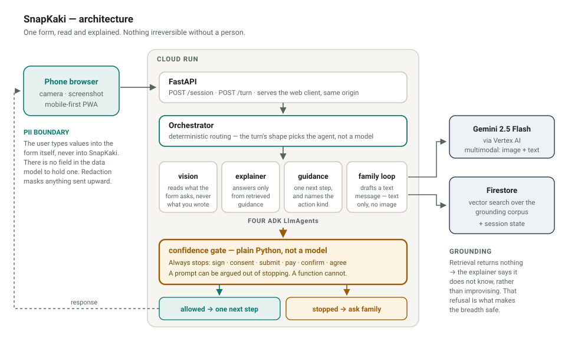

# Architecture and the decisions behind it

The shape is ordinary: a mobile web client, a FastAPI service, a model, a
vector store. What is worth arguing about is a handful of choices where the
obvious option was rejected. Each one below says what we did, what we did
not do, and what it cost.

---

## 1. The confidence gate is code, not a prompt

**Decision.** [`app/agents/confidence_gate.py`](../app/agents/confidence_gate.py)
is a pure Python function of `(action, confidence)`. No model call, no
network, no prompt. Every other sub-agent is an ADK `LlmAgent`; this one
deliberately is not.

**The alternative.** Put the rule in the system prompt — *always stop before
a signature or consent clause* — or add an LLM judge that reviews each step.
This is the standard approach and it is what most agent frameworks nudge you
toward.

**Why we rejected it.** "SnapKaki never walks you through a signature" is
either a guarantee or it is marketing. A prompt can be argued out of
stopping: by an unusual form, by an insistent user, by a phrasing nobody
anticipated, or simply by sampling variance.

We have direct evidence of that variance from this codebase. When we
benchmarked `thinking_budget=0` against the default, the *same image* came
back as 12 fields on one run and 17 on the next. If field extraction drifts
that much run to run, a safety property cannot live in the same mechanism.

A function returning `allow=False` when `action in IRREVERSIBLE_ACTIONS`
cannot drift. It is unit-tested
([`tests/test_gate.py`](../tests/test_gate.py)), it runs identically every
time, and it needs no network — so it still works when Gemini is down.

**What it cost.** The gate cannot reason about novel irreversible actions
outside its frozen set. We accept that: `guidance.py` normalises any
unrecognised action to `ask` and floors its confidence, so an unknown action
fails closed rather than open.

---

## 2. Routing is deterministic, not LLM-orchestrated

**Decision.** [`app/orchestrator.py`](../app/orchestrator.py) picks the
sub-agent from the shape of the turn. An image goes to vision, a question
about a field goes to the explainer, "what next" goes to guidance.

**The alternative.** ADK supports exactly what you would want here:
`LlmAgent(sub_agents=[...])` with model-driven transfer between agents. It
is the idiomatic framework pattern and it is more flexible.

**Why we rejected it.** The gate has to be unskippable. With LLM routing,
the gate is a sub-agent the router might not call. With deterministic
routing, it is a line of code on the single path out — every turn that can
end in an instruction goes through `_guide()`, and `_guide()` calls the gate.
You cannot add a new turn type that bypasses it without deleting that line.

The secondary reason is honest: a live demo with a non-deterministic router
is a demo that can mis-route in front of judges.

**What it cost.** Flexibility. Adding a genuinely new interaction means
writing a branch rather than describing it in a prompt. At this scope that
is a few lines, and we would make the same trade again.

---

## 3. There is no field for a value

**Decision.** The session schema ([`app/session.py`](../app/session.py))
stores field labels, kinds, printed options, and which field *keys* the user
has finished. There is no `value` anywhere in it.

**The alternative.** Store entered values encrypted at rest, which is what a
form assistant would normally do, and which would let us pre-fill, validate
and resume.

**Why we rejected it.** "We encrypt your details" is a promise about an
implementation. "There is nowhere to put your details" is a property of the
schema. The second survives a bug, a misconfiguration and a bad deploy; the
first does not. It also means there is no breach surface worth attacking.

The user types their identification number onto the paper form or into the
government's own website, where it was always going to go. SnapKaki explains
the field; it never holds the answer.

Redaction ([`app/redaction.py`](../app/redaction.py)) is the backstop for
text that slips through anyway — OCR output, a pre-filled label — and the
vision agent is instructed never to transcribe a written value, with its
output re-scanned and its confidence floored to zero if it does.

**What it cost.** No resume-with-values, no validation of what was entered,
no pre-fill. All three are real product features we gave up.

---

## 4. Grounded retrieval, not the model's own knowledge

**Decision.** The field explainer may only answer from passages retrieved
out of [`app/rag/corpus/chas.md`](../app/rag/corpus/chas.md). If retrieval
returns nothing, it says it does not know.

**The alternative.** Let Gemini answer from what it already knows about
government schemes. It knows a great deal, and the answers read well.

**Why we rejected it.** It would be confidently wrong, and we can prove it
rather than assert it. The published CHAS form changed between the Jan 2023
revision and the Dec 2025 one now on chas.sg:

| | Jan 2023 | Dec 2025 |
|---|---|---|
| Dwelling Type | broken down by room count | HDB Flat / Private Housing / Institution / Others |
| Rental Status | "Owned" | "Not Rented (e.g. bought or owned)" |
| The declaration | Clause 11 | Section 2B |

A model answering from training data answers about a form that no longer
exists, in exactly the same confident register as a correct answer. On a
document you are about to sign a truth declaration over, that is the worst
possible failure mode.

The refusal is the feature. It is also what makes the broad version of this
product safe to point at a visa form.

**What it cost.** Coverage. One corpus covers one form, and writing a corpus
is manual work. That is the unit of scale, and we would rather it be honest
work than free guessing.

---

## 5. Firestore vector search, not a dedicated vector database

**Decision.** `find_nearest()` on a Firestore collection, with the corpus
partitioned by `form_id`.

**The alternative.** Vertex AI Vector Search, or any managed vector DB.

**Why we rejected it.** At thirteen chunks, a dedicated index is cost and
operational surface for nothing. Vertex AI Vector Search carries a standing
index cost; Firestore was already in the stack for session state, so vector
search added one API call and no new service.

**What it cost.** It will not scale to millions of chunks. At the scale
where that matters, the migration is a contained change behind
`retriever.py`.

---

## 6. Retrieval degrades instead of failing

**Decision.** [`app/rag/retriever.py`](../app/rag/retriever.py) falls back
to a local keyword scorer over the same markdown when Firestore is
unreachable.

**Why.** The explainer is only allowed to speak from retrieved text, so if
retrieval dies the product goes mute. A demo that loses its network should
degrade to slightly worse explanations, not a blank screen.

This is not theoretical. During the first live test the Firestore vector
index had not finished building; the call failed, the fallback fired, and
the answer to *"I am still paying my HDB housing loan — is that renting?"*
came back correct anyway. We found out the fallback worked because we needed
it, not because we tested it.

---

## 7. Camera via `capture="environment"`, not a live preview

**Decision.** A plain `<input type="file" accept="image/*"
capture="environment">`, which opens the phone's own camera app.

**The alternative.** `getUserMedia()` with a live viewfinder in the page,
which looks considerably better.

**Why we rejected it.** This is the demo-critical path, and the native
camera is the one thing that behaves identically on iOS Safari and Android
Chrome. No permission dance, no autoplay policy, no orientation bugs. The
user also gets their own familiar camera UI, including tap-to-focus, which
matters when photographing small print.

**What it cost.** No live overlay or framing guidance. Worth it.

---

## 8. Client-side downscale before upload

**Decision.** [`web/app.js`](../web/app.js) re-encodes to a 1600px max edge
before uploading, falling back to the original file if anything in the
canvas path throws.

**Why.** A modern phone camera produces 4–8MB per shot. Over mobile data
that is the difference between a usable answer and a dead demo. Measured
upload after downscale: ~386KB, with no loss of extraction accuracy on
printed form text.

---

## 9. Firebase Hosting in front of Cloud Run

**Decision.** Static client on Firebase Hosting; `/session`, `/turn` and
`/api/**` rewritten through to the Cloud Run service.

**Why.** Static assets come off CDN edge rather than waking a container, and
the public URL reads `snapkaki.web.app` instead of a generated Cloud Run
hostname.

**Honest second reason.** The competition rules name Firebase among the
required services. We would not pretend otherwise — but we also would not
ship a service we were not genuinely using, which is why this is the hosting
path rather than a token integration.

**Verified, not assumed.** The multipart photo upload is the one thing a
rewrite hop could break, so we tested it specifically: a 386KB image reaches
Cloud Run intact through the rewrite and vision reads the page normally.

---

## 10. Stub mode is a first-class path, not a test fixture

**Decision.** `USE_STUB=true` runs the entire flow — scan, explain, guide,
gate, family hand-off — with no cloud project, no credentials and no
network.

**Why.** Two reasons, one of them unglamorous. It means the 53-test suite
runs on a clean clone with no setup, and it means there is a demo that still
works when the venue wifi does not.

The stub's field labels and printed options are copied from the published
PDF rather than invented, and a test asserts they match, so stub mode cannot
quietly drift into demonstrating a form that does not exist.

---

## What we would change

**Latency.** Reading a dense form page takes Gemini about ten seconds,
measured. We tried `thinking_budget=0` and it bought roughly 20% while
making extraction inconsistent, so we did not take it. Right now the client
escalates its waiting message instead, which is honest but not fast. The
real fix is probably a smaller first pass that returns the focused field
quickly and fills the rest behind it.

**One form.** The corpus is the unit of scale and it is hand-written. That
is the correct trade for a demo that has to be right, and the wrong one for
a product that has to be broad.

**Languages are unreviewed.** Non-English output is generated and
structurally correct, but has not been checked by native speakers. Treat the
dialect support as a demonstration of the mechanism, not a shipped feature.
